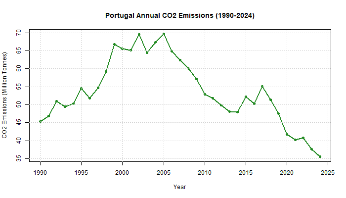
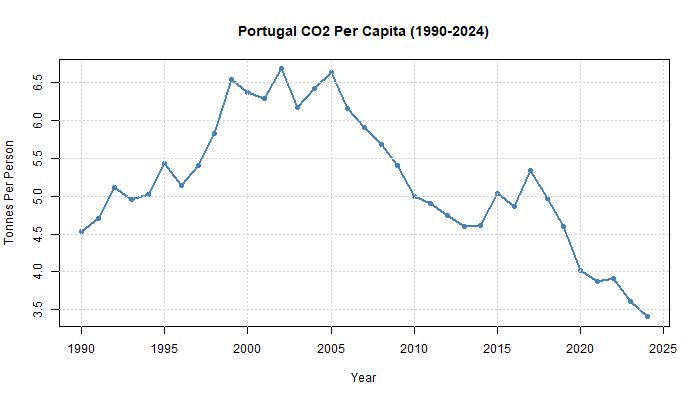
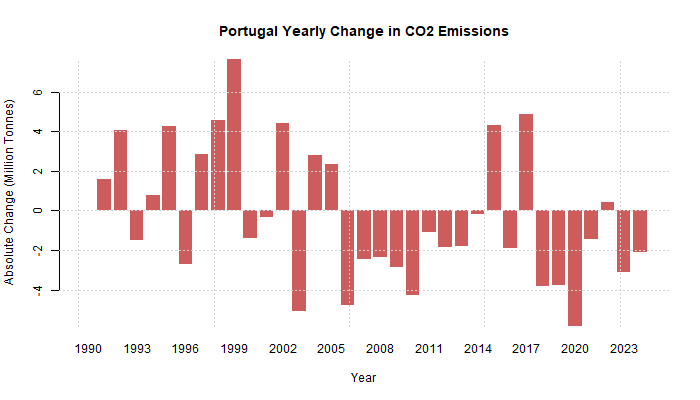

#co2-emissions-PRT
**Student:** Nehemia Padernal
**Country / ISO-3:** Portugal / PRT
**Study period:** 1990 to 2024
**Declared to instructor on:** November 14, 2026

## Research Question
How have annual CO2 emissions and per-capita emissions changed in Portugal between 1990 and 2024?

## Data Source and Definitions
Our World in Data (OWID) CO2 and Greenhouse Gas Emissions dataset.
Dataset: https://github.com/owid/co2-data
Selected columns: `year`, `co2`, `co2_per_capita`.
- `co2`: Annual territorial emissions of carbon dioxide from fossil fuels and industry (million tonnes).
- `co2_per_capita`: Annual territorial CO2 emissions divided by population (tonnes per person).

## Methods
The raw OWID dataset was filtered in R for Portugal (`iso_code == "PRT"`) covering the study window from 1990 to 2024. Missing values were preserved rather than replaced with zeros, and annual summary metrics—including endpoint percentage change, peak emission year, and yearly differences—were computed and exported alongside time-series visualizations.

## Results
In Portugal, valid annual CO2 emissions data cover the study period from 1990 (45.31 million tonnes) to 2024 (35.54 million tonnes), representing an overall endpoint percentage change of -21.57%. Absolute emissions reached their historical peak in 2005 at 69.64 million tonnes. While absolute emissions report total national carbon output in million tonnes, emissions per capita measure individual carbon footprint in tonnes per person. Both indicators generally mirror each other in trend for Portugal, shifting from rapid growth during early economic expansion to sustained reductions over the last two decades.

Below are the generated visual summary plots for Portugal's emissions:

## Interpretation
In Portugal, valid annual CO2 emissions data cover the study period from 1990 (45.31 million tonnes) to 2024 (35.54 million tonnes), representing an overall endpoint percentage change of -21.57%. Absolute emissions reached their historical peak in 2005 at 69.64 million tonnes. While absolute emissions report total national carbon output in million tonnes, emissions per capita measure individual carbon footprint in tonnes per person. This per-capita metric provides a more direct reflection of average domestic consumption intensity, ensuring that demographic shifts do not obscure broader structural decarbonization efforts across the nation. Both indicators generally mirror each other in trend for Portugal, climbing through the 1990s before reversing into a long-term decline.

A sustained trend visible in the data is the steady reduction in total CO2 emissions following their peak in 2005, dropping down to 35.54 million tonnes by 2024. A notable temporary change occurred in 2020, where annual emissions dropped sharply due to reduced industrial activity, aviation, and road transport restrictions during the COVID-19 pandemic. Subsequent post-pandemic tracking demonstrates whether this rapid drop represented a brief operational interruption or accelerated Portugal’s trajectory toward its long-term climate targets.

A plausible driver for Portugal's long-term emissions decline is its aggressive expansion of renewable electricity generation—particularly wind, solar, and hydroelectric power—alongside the complete phase-out of coal-fired power plants (such as the Sines and Pego facilities in 2021). Furthermore, national decarbonization strategies under Portugal's Roadmap for Carbon Neutrality (RNC2050) and EU Emissions Trading System incentives have steadily shifted the energy mix away from imported fossil fuels.

National emissions patterns are ecologically vital because cumulative global CO2 directly drives climate change, ocean acidification, and habitat disruption. However, a key limitation of country-level territorial data is that it only measures emissions produced physically *within* national borders, ignoring consumption-based emissions embodied in imported goods and services.

## Limitations
- **Territorial Accounting:** The dataset relies on territorial carbon accounting, which only tracks emissions produced *within* Portugal's physical borders. It omits "embodied" emissions from imported goods and services consumed by the population.
- **Exclusion of Land-Use Change:** The main `co2` indicator accounts strictly for fossil fuels and industrial processes, excluding emissions or carbon sequestration from land-use change, forestry, and agriculture.
- **Data Gaps and Estimates:** These figures are emission estimates rather than direct atmospheric measurements or tracking of all greenhouse gases, and missing historical years must never be treated as zero.
- **Cross-Country Comparability:** Raw national totals can be misleading when comparing countries of vastly different geographic sizes or populations without scaling per capita.

## References
- Friedlingstein, P., et al. (2024). Global Carbon Budget 2024. *Earth System Science Data*.
- Our World in Data (OWID). (2024). *CO2 and Greenhouse Gas Emissions Dataset*. Retrieved from https://github.com/owid/co2-data
- Portuguese Environment Agency (APA). (2021). *Roadmap for Carbon Neutrality 2050 (RNC2050)*.

